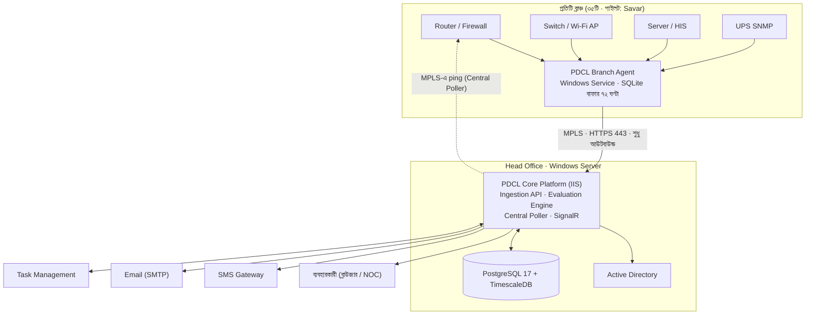

# CBH-NMS — Software Requirements Specification (SRS)

Centralized Branch-to-Head Office Network Monitoring System · Popular Diagnostic Centre Ltd. (PDCL)

সংস্করণ 0.2 (খসড়া: Windows-নেটিভ + PostgreSQL) · Nov 9, 2026 · প্রস্তুতকারী: Maruf Ahmed

## ১. ভূমিকা

এই SRS দিয়ে CBH-NMS-এর MVP (পাইলট: ২-৩টি ব্রাঞ্চ) এবং পরের দুই ধাপের জন্য কী বানাতে হবে তা নির্ধারণ করা হয়েছে। ডেভেলপমেন্ট, টেস্টিং ও গ্রহণযোগ্যতা যাচাই সব এই ডকুমেন্ট অনুযায়ী চলবে।

### ১.১ উদ্দেশ্য

Head Office IT টিম যেন সব ব্রাঞ্চের নেটওয়ার্ক, বিদ্যুৎ (UPS), সার্ভার ও HIS-এর অবস্থা এক জায়গা থেকে রিয়েল-টাইমে দেখতে পায়। কোনো সমস্যা হলে স্বয়ংক্রিয়ভাবে অ্যালার্ট ও টিকিট তৈরি হবে, এবং MTTD/MTTR মাপা যাবে।

### ১.২ পরিধি

**অন্তর্ভুক্ত:** ব্রাঞ্চ ও ডিভাইস মনিটরিং (ICMP, SNMPv3), ISP/WAN/VPN অবস্থা, UPS ও বিদ্যুৎ, সার্ভার রিসোর্স, HIS/LIS অ্যাপ্লিকেশন health check, অ্যালার্ট ও এসকেলেশন, Task Management-এ টিকিট, রিপোর্ট, রোলভিত্তিক অ্যাক্সেস।

**বহির্ভুক্ত (এই সংস্করণে):** ডিভাইসের কনফিগারেশন পরিবর্তন বা রিমোট কনফিগ পুশ, পূর্ণ SIEM/IDS, এন্ডপয়েন্ট (PC) মনিটরিং, প্যাকেট ক্যাপচার, AI-ভিত্তিক পূর্বাভাস (Phase 3-এ বিবেচনা)।

### ১.৩ সংজ্ঞা ও সংক্ষেপ

| শব্দ | অর্থ |
| --- | --- |
| HO | Head Office |
| Branch Agent | প্রতিটি ব্রাঞ্চের একটি Windows PC/সার্ভারে চলা PDCL-এর নিজস্ব Windows Service, যা স্থানীয় ডিভাইস poll করে ও HO-তে ডেটা পাঠায় |
| Central Poller | HO-তে চলা Windows Service, যা MPLS দিয়ে প্রতিটি ব্রাঞ্চ রাউটার ping করে ও এজেন্টের heartbeat নজরে রাখে |
| Core Platform | PDCL-এর ASP.NET Core অ্যাপ্লিকেশন (Ingestion API, Evaluation Engine, ড্যাশবোর্ড, ইনসিডেন্ট, রিপোর্ট) |
| Evaluation Engine | Core Platform-এর অংশ, যা metric-এর সাথে alert rule মিলিয়ে অ্যালার্ট ও অবস্থা তৈরি করে |
| Hypertable | TimescaleDB-এর টেবিল, যা সময় অনুযায়ী স্বয়ংক্রিয়ভাবে ভাগ (chunk) হয় |
| Incident | এক বা একাধিক সম্পর্কিত অ্যালার্ট থেকে তৈরি একটি ঘটনা |
| MTTD / MTTR | সমস্যা শনাক্তের গড় সময় / সমাধানের গড় সময় |
| Dependency | প্যারেন্ট-চাইল্ড সম্পর্ক (যেমন রাউটার → সুইচ → সার্ভার), অ্যালার্ট দমনে ব্যবহৃত |
| SLA Availability | (মোট সময় − অপরিকল্পিত downtime) ÷ মোট সময় × ১০০ |

### ১.৪ রেফারেন্স

- CBH-NMS প্রাথমিক প্রস্তাবনা (Project Concept / Initial Proposal)
- IEEE 830 / ISO/IEC/IEEE 29148 — SRS কাঠামো
- PDCL IT Task Management Software (ইন্টিগ্রেশনের জন্য API ডকুমেন্টেশন প্রয়োজন)

### ১.৫ ডকুমেন্ট কনভেনশন

- প্রতিটি রিকোয়ারমেন্টের একটি আইডি আছে: **FR-**(ফাংশনাল), **NFR-**(নন-ফাংশনাল), **INT-**(ইন্টিগ্রেশন)।
- অগ্রাধিকার: **M** = MVP-তে আবশ্যক, **P2** = Phase 2, **P3** = Phase 3।
- "করবে" = বাধ্যতামূলক; "করতে পারবে" = ঐচ্ছিক।

## ২. সামগ্রিক বিবরণ

CBH-NMS হবে সম্পূর্ণ Windows-নেটিভ, নিজস্বভাবে তৈরি সিস্টেম: ব্রাঞ্চে একটি .NET Windows Service (Branch Agent), HO-তে ASP.NET Core অ্যাপ্লিকেশন (Core Platform) ও বিনামূল্যের PostgreSQL + TimescaleDB ডেটাবেস। কোথাও Linux বা তৃতীয় পক্ষের মনিটরিং টুল লাগবে না; বিনিময়ে Zabbix-ভিত্তিক নকশার চেয়ে ডেভেলপমেন্টে ৪-৬ সপ্তাহ বেশি লাগবে।

### ২.১ প্রোডাক্ট পারস্পেক্টিভ: কোন অংশ কে করবে

| দায়িত্ব | Branch Agent (ব্রাঞ্চ) | Core Platform (HO) |
| --- | --- | --- |
| SNMPv3, ICMP, HTTP/TCP check, ভেন্ডর API (FortiGate, MikroTik) | ✓ | — |
| সংযোগ না থাকলে স্থানীয় বাফার (store-and-forward) | ✓ (SQLite) | — |
| ব্রাঞ্চ রাউটারে স্বাধীন ping ও heartbeat নজরদারি | — | ✓ (Central Poller) |
| Metric সংরক্ষণ, সারসংক্ষেপ, কম্প্রেশন | — | ✓ (TimescaleDB) |
| Threshold মূল্যায়ন, অবস্থা ইঞ্জিন, অ্যালার্ট | — | ✓ (Evaluation Engine) |
| ইনসিডেন্ট, এসকেলেশন, SLA, রিপোর্ট | — | ✓ |
| SMS, Email, Task Management টিকিট | — | ✓ |
| ব্রাঞ্চ/ডিভাইস কনফিগ | HO থেকে টেনে নেয় | ✓ (একমাত্র উৎস) |

এজেন্ট শুধু ডেটা সংগ্রহ করে; কোনটা সমস্যা আর কাকে জানাতে হবে, সেই সিদ্ধান্ত সবসময় HO-তে হবে। ফলে নিয়ম বদলাতে ৩৫টি ব্রাঞ্চে আলাদা করে কিছু ইনস্টল করতে হয় না।

### ২.২ ব্যবহারকারী শ্রেণী

| রোল | কাজ | ব্যবহারের ধরন |
| --- | --- | --- |
| Super Administrator | সিস্টেম কনফিগ, ইউজার, ইন্টিগ্রেশন | মাঝে মাঝে |
| Head of IT | সব ব্রাঞ্চের অবস্থা, SLA, এসকেলেশন গ্রহণ | দৈনিক |
| IT Manager | নির্ধারিত অঞ্চলের ইনসিডেন্ট তদারকি | দিনভর |
| Network Administrator / NOC Engineer | লাইভ মনিটরিং, ইনসিডেন্ট সমাধান, ডিভাইস ম্যানেজমেন্ট | সারাক্ষণ (NOC স্ক্রিন) |
| Branch IT Engineer | নিজের ব্রাঞ্চের অ্যালার্ট, ইনসিডেন্ট আপডেট | মোবাইল/SMS দিয়ে |
| Management (Read-only) | এক্সিকিউটিভ ড্যাশবোর্ড, মাসিক রিপোর্ট | সাপ্তাহিক/মাসিক |

### ২.৩ অপারেটিং পরিবেশ

- **HO অ্যাপ সার্ভার:** Windows Server 2022/2025, IIS 10, .NET 10 (LTS) Hosting Bundle; Core Platform ও Central Poller এখানে চলবে।
- **HO ডেটাবেস সার্ভার:** আলাদা Windows Server-এ PostgreSQL 17 + TimescaleDB (Windows installer); প্রাথমিক আকার ৮ vCPU, ৩২ GB RAM, ৫০০ GB SSD (পাইলটে মেপে চূড়ান্ত)।
- **ব্রাঞ্চ:** বিদ্যমান একটি Windows 10/11 বা Windows Server মেশিন, যেটা সবসময় চালু থাকে ও UPS-এ যুক্ত; এজেন্টের জন্য ২০০ MB RAM ও ২ GB ডিস্ক যথেষ্ট।
- **ক্লায়েন্ট:** Chrome/Edge (সর্বশেষ দুই সংস্করণ), মোবাইল-responsive; NOC ডিসপ্লে 1920×1080।
- **ডেভেলপমেন্ট:** Visual Studio 2022+, C#, EF Core + Npgsql, React + TypeScript; ইন-হাউস ডেভেলপমেন্ট টিম।

### ২.৪ সীমাবদ্ধতা

- সব কম্পোনেন্ট Windows-এ চলবে; Linux সার্ভার, VM বা WSL ব্যবহার করা হবে না।
- শুধু SNMPv3 (authPriv: SHA + AES); v1/v2c ব্যবহার নিষিদ্ধ।
- ব্রাঞ্চে কোনো inbound port খোলা হবে না; এজেন্ট MPLS দিয়ে HO-র দিকে শুধু HTTPS (443) আউটবাউন্ড সংযোগ করবে।
- ডিভাইসে এজেন্ট শুধু পড়বে (read-only SNMP user, read-only API অ্যাকাউন্ট); কনফিগ পরিবর্তন করবে না।
- ডিভাইস ডিসকভারি স্ক্যান চলবে শুধু Change Management অনুমোদনের পরে, নির্ধারিত subnet-এ।
- ব্যবহারকারী অথেনটিকেশন Active Directory দিয়ে; আলাদা পাসওয়ার্ড ডাটাবেস নেই (শুধু একটি break-glass অ্যাকাউন্ট)।
- SMS খরচ মাসিক ৳২,০০০-এর মধ্যে রাখতে হবে; তাই SMS শুধু Critical/High-এ ও দৈনিক সীমাসহ যাবে (নিয়ম ৯.২)।

### ২.৫ অনুমান ও নির্ভরতা

- PDCL-এর ৩৫টি ব্রাঞ্চ ও প্রায় ৩০০টি ডিভাইস মনিটর করতে হবে।
- ব্রাঞ্চ ও HO-র মধ্যে MPLS সংযোগ আছে; প্রতিটি ব্রাঞ্চে ইন্টারনেটের জন্য এক বা একাধিক ISP লিংক।
- রাউটার/ফায়ারওয়াল Fortinet, Cisco ও MikroTik; সব SNMPv3 সমর্থন করে (পুরনো মডেল পাইলটে যাচাই হবে)।
- ৭০টি UPS-এ SNMP কার্ড আছে; এগুলো সরাসরি SNMP (UPS-MIB) দিয়ে মনিটর হবে। কোন ব্রাঞ্চের UPS-এ কার্ড নেই তা ইনভেন্টরিতে চিহ্নিত হবে; সেখানে Power/ISP আলাদা করা সীমিত থাকবে।
- IT Task Management Software-এর REST API আছে বা তৈরি করা যাবে।
- HIS বিক্রেতা ASPL একটি health endpoint দেবে (নিশ্চিত)।

## ৩. সিস্টেম আর্কিটেকচার

প্রতিটি ব্রাঞ্চে একটি Branch Agent (Windows Service) স্থানীয় ডিভাইস poll করে ও MPLS দিয়ে শুধু বাইরের দিকে HTTPS-এ HO-তে পাঠায়; HO-তে Core Platform অবস্থা নির্ধারণ, অ্যালার্ট ও ইনসিডেন্ট সামলায়, আর Central Poller এজেন্টের উপর নির্ভর না করে ব্রাঞ্চ রাউটার যাচাই করে।



### ৩.১ কম্পোনেন্ট

| কম্পোনেন্ট | অবস্থান | প্রযুক্তি | দায়িত্ব |
| --- | --- | --- | --- |
| Branch Agent | প্রতিটি ব্রাঞ্চের একটি Windows মেশিন | .NET 10 Worker Service (Windows Service), SharpSnmpLib (SNMPv3), System.Net Ping, SQLite, MSI ইনস্টলার | স্থানীয় polling, বাফার, HO-তে ব্যাচে পাঠানো, heartbeat |
| Central Poller | HO অ্যাপ সার্ভার | .NET 10 Windows Service | MPLS দিয়ে ৩০ সেকেন্ড পরপর ব্রাঞ্চ রাউটার ping; এজেন্ট heartbeat হারালে সতর্ক |
| Ingestion API | Core Platform-এর অংশ (IIS) | ASP.NET Core 10 | এজেন্টের ব্যাচ গ্রহণ, যাচাই, ডুপ্লিকেট বাদ, দ্রুত bulk insert (COPY) |
| Evaluation Engine | Core Platform worker | .NET BackgroundService | প্রতি ১৫ সেকেন্ডে alert rule মূল্যায়ন, অবস্থা ইঞ্জিন (৯.১), suppression |
| Core Platform API | HO, Windows Server + IIS | ASP.NET Core 10 Web API, SignalR | REST, রিয়েল-টাইম, ব্যবসায়িক লজিক |
| Background Jobs | Core Platform-এর অংশ | Hangfire (PostgreSQL storage) | এসকেলেশন টাইমার, নোটিফিকেশন পুনঃচেষ্টা, মাসিক রিপোর্ট Email |
| ফ্রন্টএন্ড | IIS-এ স্ট্যাটিক | React + TypeScript, ApexCharts | ড্যাশবোর্ড ও স্ক্রিন |
| ডেটাবেস | HO, আলাদা Windows Server | PostgreSQL 17 + TimescaleDB | মাস্টার, raw metric (hypertable), সারসংক্ষেপ, ইনসিডেন্ট, অডিট |

**ভেন্ডরভিত্তিক প্রোফাইল:** এজেন্টে Fortinet (FortiGate), Cisco ও MikroTik-এর জন্য আলাদা OID প্রোফাইল থাকবে (CPU, memory, interface, VPN/SD-WAN অবস্থা), আর প্রয়োজনে FortiGate REST API ও MikroTik RouterOS API (read-only) ব্যবহার হবে। প্রোফাইল HO থেকে কনফিগ হিসেবে আসে, তাই নতুন মডেল যোগ করতে এজেন্ট আপডেট লাগে না।

### ৩.২ ডেটা ফ্লো: একটি ISP বিভ্রাট

1. এজেন্ট ৬০ সেকেন্ড পরপর Primary ISP-এর বাইরের লক্ষ্যে ping করে ও ফলাফল স্থানীয় SQLite-এ লেখে।
2. প্রতি ৬০ সেকেন্ডে এজেন্ট অপ্রেরিত সব metric একটি ব্যাচে Ingestion API-তে পাঠায়; HO গ্রহণ নিশ্চিত করলে বাফার থেকে মোছে।
3. Evaluation Engine দেখে পরপর ৪টি ping ব্যর্থ → অ্যালার্ট তৈরি করে ও অবস্থা ইঞ্জিন চালায় (নিয়ম ৯.১)।
4. ব্রাঞ্চ "Degraded" হয়; SignalR দিয়ে সব খোলা ড্যাশবোর্ডে আপডেট যায়।
5. High severity হওয়ায় Branch Engineer ও NOC SMS + Email পায়।
6. ৩ মিনিট পরেও সক্রিয় থাকলে ইনসিডেন্ট ও Task Management টিকিট তৈরি হয়।
7. ISP ফিরলে Evaluation Engine অ্যালার্ট clear করে; ইনসিডেন্ট মানুষ root cause দিয়ে Resolve করে।

পুরো ব্রাঞ্চ বিচ্ছিন্ন হলে (MPLS বা বিদ্যুৎ) এজেন্ট কিছু পাঠাতে পারে না; তখন Central Poller-এর ping ব্যর্থতা ও heartbeat না আসা থেকেই সমস্যা ধরা পড়ে।

### ৩.৩ Store-and-forward

HO-র সাথে সংযোগ না থাকলে এজেন্ট স্থানীয় SQLite ফাইলে ৭২ ঘণ্টা পর্যন্ত ডেটা রাখে ও সংযোগ ফিরলে পুরনো ডেটা আগে পাঠায় (প্রতি ব্যাচে সর্বোচ্চ ৫,০০০ সারি)। প্রতিটি সারিতে এজেন্ট-প্রদত্ত ক্রমিক নম্বর থাকে, তাই একই ব্যাচ দুবার এলেও HO দুবার সংরক্ষণ করে না। বাফার ভরে গেলে সবচেয়ে পুরনো ডেটা আগে মোছে, কিন্তু অবস্থা পরিবর্তনের ইভেন্ট (যেমন UPS on-battery) কখনো মোছে না। ফলে downtime-এর সময়ের তথ্যও হারায় না, যা root cause বিশ্লেষণে লাগে।

### ৩.৪ নেটওয়ার্ক ও পোর্ট

| উৎস | গন্তব্য | পোর্ট | উদ্দেশ্য |
| --- | --- | --- | --- |
| Branch Agent | HO Core Platform (MPLS) | 443/TCP (HTTPS) | metric, ইভেন্ট, heartbeat, কনফিগ টানা |
| Branch Agent | স্থানীয় ডিভাইস | 161/UDP, ICMP | SNMPv3 poll, ping |
| Branch Agent | FortiGate / MikroTik | 443/TCP, 8729/TCP (API-SSL) | read-only API |
| স্থানীয় ডিভাইস | Branch Agent | 162/UDP, 514/UDP | SNMP trap, syslog (P2) |
| Central Poller (HO) | ব্রাঞ্চ রাউটার (MPLS) | ICMP | স্বাধীন reachability |
| Core Platform | PostgreSQL সার্ভার | 5432/TCP (TLS) | ডেটাবেস |
| ব্যবহারকারী | Core Platform | 443/TCP | ওয়েব ও SignalR (WebSocket) |
| Core Platform | SMS gateway, SMTP, Task Mgmt, AD | 443, 587, 443, 636/TCP | ইন্টিগ্রেশন |

## ৪. মডিউলভিত্তিক ফাংশনাল রিকোয়ারমেন্ট

মোট ১০টি মডিউলে ৫৬টি রিকোয়ারমেন্ট; এর মধ্যে **M** চিহ্নিতগুলো পাইলট রিলিজে থাকতেই হবে।

### ৪.১ ব্রাঞ্চ ও ইনভেন্টরি ম্যানেজমেন্ট (BR)

| ID | রিকোয়ারমেন্ট | অগ্রাধিকার |
| --- | --- | --- |
| FR-BR-01 | সিস্টেম ব্রাঞ্চ তৈরি/সম্পাদনা/নিষ্ক্রিয় করতে দেবে: কোড, নাম, অঞ্চল, ঠিকানা, GPS, ক্রিটিক্যালিটি (Tier 1/2/3), কাজের সময়। | M |
| FR-BR-02 | প্রতিটি ব্রাঞ্চে একাধিক ISP লিংক (Primary/Secondary), ব্যান্ডউইথ, সার্কিট ID ও ISP সাপোর্ট নম্বর রাখা যাবে। | M |
| FR-BR-03 | ডিভাইস ইনভেন্টরি: ধরন, ব্র্যান্ড/মডেল, IP, MAC, সিরিয়াল, ফার্মওয়্যার, ওয়ারেন্টির মেয়াদ, মনিটরিং টেমপ্লেট। | M |
| FR-BR-04 | ডিভাইসের প্যারেন্ট (dependency) নির্ধারণ করা যাবে; ব্রাঞ্চ রাউটার সবসময় শীর্ষ প্যারেন্ট। | M |
| FR-BR-05 | এজেন্ট ব্যবস্থাপনা: এককালীন টোকেন দিয়ে এজেন্ট রেজিস্ট্রেশন; ব্রাঞ্চ/ডিভাইস সংরক্ষণ করলে এজেন্ট ৫ মিনিটের মধ্যে নতুন কনফিগ টেনে নেবে; এজেন্টের সংস্করণ, শেষ heartbeat ও বাফারের আকার দেখা যাবে। | M |
| FR-BR-06 | Excel/CSV থেকে বাল্ক ইমপোর্ট, ভ্যালিডেশন রিপোর্টসহ। | M |
| FR-BR-07 | অনুমোদিত subnet-এ নিয়ন্ত্রিত ডিসকভারি; নতুন পাওয়া ডিভাইস "অপরিচিত" হিসেবে অনুমোদনের অপেক্ষায় থাকবে। | P2 |

### ৪.২ সংযোগ ও উপলভ্যতা মনিটরিং (AV)

| ID | রিকোয়ারমেন্ট | অগ্রাধিকার |
| --- | --- | --- |
| FR-AV-01 | প্রতিটি ব্রাঞ্চের গেটওয়ে থেকে HO পর্যন্ত ৬০ সেকেন্ড অন্তর ICMP: latency, jitter, packet loss। | M |
| FR-AV-02 | প্রতিটি ISP লিংকের আলাদা অবস্থা (WAN interface + বাইরের লক্ষ্যে ping); failover ঘটলে ইভেন্ট লগ হবে। | M |
| FR-AV-03 | VPN/IPsec tunnel অবস্থা (SNMP বা ফায়ারওয়াল API)। | M |
| FR-AV-04 | ব্রাঞ্চের সামগ্রিক অবস্থা পাঁচটি মানে: Online, Degraded, Offline-ISP, Offline-Power, Unknown (নিয়ম ৯.১-এ)। | M |
| FR-AV-05 | এজেন্টের heartbeat ৩ মিনিট না এলে কিন্তু Central Poller-এর ping সফল হলে ব্রাঞ্চ "Unknown/Monitoring Lost" হবে, "Offline" নয়। | M |
| FR-AV-06 | ব্রাঞ্চের মাসিক availability % হিসাব, পরিকল্পিত maintenance বাদ দিয়ে। | M |

### ৪.৩ ডিভাইস ও সার্ভার মনিটরিং (DV)

| ID | রিকোয়ারমেন্ট | অগ্রাধিকার |
| --- | --- | --- |
| FR-DV-01 | রাউটার/ফায়ারওয়াল: CPU, memory, uptime, interface up/down, session count। | M |
| FR-DV-02 | ম্যানেজড সুইচ: পোর্ট অবস্থা, error/discard, uplink utilization। | P2 |
| FR-DV-03 | সার্ভার (Windows/Linux): CPU, RAM, ডিস্ক খালি জায়গা, গুরুত্বপূর্ণ Windows service। | M |
| FR-DV-04 | UPS: input voltage, on-battery অবস্থা, battery %, অবশিষ্ট runtime (UPS-MIB / RFC 1628)। | M |
| FR-DV-05 | Wi-Fi access point online/offline ও ক্লায়েন্ট সংখ্যা। | P2 |
| FR-DV-06 | ডিভাইস syslog HO-তে কেন্দ্রীভূত, severity অনুযায়ী ফিল্টার। | P2 |

### ৪.৪ ব্যান্ডউইথ ও পারফরম্যান্স (BW)

| ID | রিকোয়ারমেন্ট | অগ্রাধিকার |
| --- | --- | --- |
| FR-BW-01 | WAN interface-এর in/out ট্রাফিক (Mbps) ৬০ সেকেন্ড অন্তর, চুক্তিকৃত ব্যান্ডউইথের % হিসেবেও। | P2 |
| FR-BW-02 | টানা ১৫ মিনিট ৬০% (সতর্কতা) বা ৯০% (গুরুতর) ছাড়ালে অ্যালার্ট; সীমা ব্রাঞ্চভিত্তিক পরিবর্তনযোগ্য। | P2 |
| FR-BW-03 | দিনে ২ বার নির্ধারিত সময়ে (অফ-পিক) হালকা স্পিড টেস্ট, ফলাফল ISP পারফরম্যান্সে যোগ। | P2 |
| FR-BW-04 | ট্র্যাফিক ট্রেন্ড: ২৪ ঘণ্টা, ৭ দিন, ৩০ দিন, ১২ মাস গ্রাফ। | P2 |

### ৪.৫ অ্যাপ্লিকেশন হেলথ — HIS/LIS (AP)

| ID | রিকোয়ারমেন্ট | অগ্রাধিকার |
| --- | --- | --- |
| FR-AP-01 | প্রতিটি ব্রাঞ্চ থেকে HIS অ্যাপ্লিকেশনের URL-এ HTTP(S) চেক: স্ট্যাটাস কোড ও response time। | M |
| FR-AP-02 | HIS ডাটাবেস পোর্টে TCP সংযোগ চেক (ব্রাঞ্চ থেকে দেখা অবস্থা)। | M |
| FR-AP-03 | ল্যাব মেশিন ইন্টারফেস সার্ভিস (LIS middleware) চলছে কিনা, ও শেষ ফলাফল কত মিনিট আগে এসেছে। | P2 |
| FR-AP-04 | প্রতিটি অ্যাপ্লিকেশন চেক কোন ব্যবসায়িক সেবার সাথে যুক্ত তা উল্লেখ (Registration, Billing, Lab Report)। | P2 |

### ৪.৬ অ্যালার্ট ও নোটিফিকেশন (AL)

| ID | রিকোয়ারমেন্ট | অগ্রাধিকার |
| --- | --- | --- |
| FR-AL-01 | Evaluation Engine প্রতি ১৫ সেকেন্ডে সক্রিয় alert rule (metric, threshold, সময়কাল, severity) মূল্যায়ন করবে; প্রতিটি problem/recovery সংরক্ষিত হবে। Rule UI থেকে বদলানো যাবে, রিডিপ্লয় ছাড়াই। | M |
| FR-AL-02 | Severity চার স্তর: Critical, High, Warning, Info। | M |
| FR-AL-03 | Dependency suppression: প্যারেন্ট down থাকলে চাইল্ডের অ্যালার্ট নোটিফাই হবে না, শুধু লগ হবে। | M |
| FR-AL-04 | Flapping নিয়ন্ত্রণ: ১০ মিনিটে ৩ বারের বেশি অবস্থা পরিবর্তন হলে একটি "Unstable" অ্যালার্ট, প্রতিটির জন্য আলাদা নয়। | M |
| FR-AL-05 | Maintenance window: ব্রাঞ্চ বা ডিভাইসে নির্ধারিত সময়ে অ্যালার্ট বন্ধ, SLA থেকে বাদ। | M |
| FR-AL-06 | চ্যানেল: Email (সব severity), SMS (Critical/High), ড্যাশবোর্ডে রিয়েল-টাইম পপআপ। WhatsApp = P3। | M |
| FR-AL-07 | রিসিপিয়েন্ট নিয়ম: ব্রাঞ্চ + severity + সময় (অফিস সময়/রাত) অনুযায়ী কাকে জানানো হবে। | M |
| FR-AL-08 | অ্যালার্ট Acknowledge করলে পুনরাবৃত্তি নোটিফিকেশন বন্ধ; কে কখন Ack করেছে লগ হবে। | M |

### ৪.৭ ইনসিডেন্ট ও এসকেলেশন (IN)

| ID | রিকোয়ারমেন্ট | অগ্রাধিকার |
| --- | --- | --- |
| FR-IN-01 | Critical/High অ্যালার্ট ৩ মিনিট ধরে থাকলে স্বয়ংক্রিয়ভাবে ইনসিডেন্ট তৈরি; একই ব্রাঞ্চের সম্পর্কিত অ্যালার্ট একই ইনসিডেন্টে যুক্ত। | M |
| FR-IN-02 | ইনসিডেন্ট তৈরি হলে Task Management Software-এ টিকিট তৈরি ও দুই দিকে অবস্থা সিঙ্ক (INT-01)। | M |
| FR-IN-03 | অবস্থা: Open → Acknowledged → In Progress → Resolved → Closed; প্রতিটি পরিবর্তন টাইমস্ট্যাম্পসহ। | M |
| FR-IN-04 | Root cause ক্যাটাগরি বাধ্যতামূলক (Resolved করার সময়): ISP, Power, Hardware, Config, HIS, Unknown। | M |
| FR-IN-05 | এসকেলেশন: নির্ধারিত সময়ে Ack না হলে পরের স্তরে (Branch Engineer → IT Manager → Head of IT)। | M |
| FR-IN-06 | MTTD, MTTA, MTTR স্বয়ংক্রিয়ভাবে হিসাব। | M |
| FR-IN-07 | একই ব্রাঞ্চে ৭ দিনে একই root cause-এ ৩+ ইনসিডেন্ট হলে "Repeat failure" ফ্ল্যাগ। | P2 |

### ৪.৮ ড্যাশবোর্ড ও ভিজুয়ালাইজেশন (DB)

| ID | রিকোয়ারমেন্ট | অগ্রাধিকার |
| --- | --- | --- |
| FR-DB-01 | সামগ্রিক KPI: মোট/Online/Degraded/Offline ব্রাঞ্চ, আজকের availability, খোলা ইনসিডেন্ট। | M |
| FR-DB-02 | সব ব্রাঞ্চের টাইল/গ্রিড ভিউ, রঙ ও আইকন দিয়ে অবস্থা (শুধু রঙে নয়)। | M |
| FR-DB-03 | বাংলাদেশের মানচিত্রে ব্রাঞ্চ ম্যাপ (Leaflet + OpenStreetMap)। | P2 |
| FR-DB-04 | SignalR দিয়ে পেজ রিফ্রেশ ছাড়াই অবস্থা আপডেট (১০ সেকেন্ডের মধ্যে)। | M |
| FR-DB-05 | NOC মোড: ফুলস্ক্রিন, অটো-স্ক্রল, নতুন Critical-এ শব্দ সতর্কতা। | P2 |

### ৪.৯ রিপোর্ট ও অ্যানালিটিক্স (RP)

| ID | রিকোয়ারমেন্ট | অগ্রাধিকার |
| --- | --- | --- |
| FR-RP-01 | ব্রাঞ্চভিত্তিক মাসিক availability রিপোর্ট, SLA লক্ষ্যমাত্রার সাথে তুলনা। | M |
| FR-RP-02 | ইনসিডেন্ট রিপোর্ট: ব্রাঞ্চ, root cause, MTTR অনুযায়ী। | M |
| FR-RP-03 | ISP তুলনা: availability, গড় latency, packet loss, ইনসিডেন্ট সংখ্যা (বিক্রেতা আলোচনার জন্য)। | P2 |
| FR-RP-04 | পাওয়ার রিপোর্ট: ব্রাঞ্চভিত্তিক বিদ্যুৎ বিভ্রাটের সংখ্যা ও UPS-এ চলা সময়। | P2 |
| FR-RP-05 | সব রিপোর্ট PDF ও Excel-এ এক্সপোর্ট; মাসিক রিপোর্ট মাসের ১ তারিখে স্বয়ংক্রিয় Email। | M |

### ৪.১০ ইউজার, রোল ও অডিট (US)

| ID | রিকোয়ারমেন্ট | অগ্রাধিকার |
| --- | --- | --- |
| FR-US-01 | Active Directory (LDAPS / Windows Auth) দিয়ে লগইন; AD group → রোল ম্যাপিং। | M |
| FR-US-02 | রোলের সাথে ব্রাঞ্চ-স্কোপ: ইউজার শুধু নির্ধারিত ব্রাঞ্চ/অঞ্চল দেখবে। | M |
| FR-US-03 | অডিট লগ: লগইন, কনফিগ পরিবর্তন, Ack, ইনসিডেন্ট আপডেট, এক্সপোর্ট — কে, কখন, কোথা থেকে, আগে/পরের মান। | M |
| FR-US-04 | অডিট লগ পরিবর্তন বা মুছে ফেলা যাবে না (append-only)। | M |

## ৫. নন-ফাংশনাল রিকোয়ারমেন্ট

মনিটরিং সিস্টেমের নিজের availability হতে হবে ৯৯.৯%, আর সমস্যা ঘটার ২ মিনিটের মধ্যে অ্যালার্ট পৌঁছাতে হবে; এই দুটি মান পাইলট গ্রহণযোগ্যতার মূল শর্ত।

| ID | বিষয় | রিকোয়ারমেন্ট |
| --- | --- | --- |
| NFR-01 | শনাক্তকরণের সময় | ব্রাঞ্চ offline হওয়ার ২ মিনিটের মধ্যে ড্যাশবোর্ডে দেখা যাবে, ৩ মিনিটের মধ্যে SMS পৌঁছাবে |
| NFR-02 | ড্যাশবোর্ড গতি | মূল ড্যাশবোর্ড ২ সেকেন্ডে লোড (৫০ সমকালীন ইউজার); ১২ মাসের রিপোর্ট ৫ সেকেন্ডে (continuous aggregate থেকে পড়া) |
| NFR-03 | স্কেল | বর্তমান: ৩৫ ব্রাঞ্চ, ৩০০ ডিভাইস (আনুমানিক ৪,৫০০ metric/মিনিট, দিনে প্রায় ৬৫ লাখ সারি); আর্কিটেকচার পরিবর্তন ছাড়া ১৫০ ব্রাঞ্চ ও ৫,০০০ ডিভাইস |
| NFR-04 | সিস্টেমের নিজস্ব প্রাপ্যতা | ৯৯.৯% মাসিক; PostgreSQL-এর গরম স্ট্যান্ডবাই (streaming replication, Windows-এ সমর্থিত) P2-তে; MVP-তে ব্যাকআপ থেকে পুনরুদ্ধার |
| NFR-05 | Store-and-forward | ব্রাঞ্চ নেট না থাকলে এজেন্ট SQLite-এ কমপক্ষে ৭২ ঘণ্টার ডেটা রাখবে ও সংযোগ ফিরলে পাঠাবে; কোনো সারি দুবার সংরক্ষিত হবে না |
| NFR-06 | ব্যান্ডউইথ প্রভাব | প্রতি ব্রাঞ্চে মনিটরিং ট্রাফিক গড়ে ৩০ kbps-এর কম (ব্যাচ gzip করা থাকবে; পাইলটে মাপা হবে) |
| NFR-07 | এজেন্টের রিসোর্স | গড়ে CPU < ৫%, RAM < ১৫০ MB; Windows রিস্টার্টে স্বয়ংক্রিয় চালু (Automatic, ব্যর্থ হলে পুনঃচালু) |
| NFR-08 | এনক্রিপশন | এজেন্ট ↔ HO: TLS 1.2+ (Windows Schannel); ব্রাউজার: HTTPS + HSTS; Core ↔ PostgreSQL: TLS; ডিভাইস credential ডেটাবেসে এনক্রিপ্টেড (ASP.NET Data Protection) |
| NFR-09 | এজেন্ট অথেনটিকেশন | প্রতিটি এজেন্টের আলাদা key, ব্রাঞ্চ মেশিনে Windows DPAPI দিয়ে সংরক্ষিত; HO-তে শুধু hash; একটি এজেন্ট বাতিল করলে অন্যগুলো অপরিবর্তিত |
| NFR-10 | অ্যাক্সেস নিয়ন্ত্রণ | RBAC + ব্রাঞ্চ স্কোপ; Super Admin-এ MFA; সার্ভার Management VLAN-এ, ফায়ারওয়ালে শুধু ৩.৪-এর পোর্ট |
| NFR-11 | ডেটা রিটেনশন | Raw metric ৩০ দিন (৭ দিনের পুরনোগুলো কম্প্রেসড), ঘণ্টাভিত্তিক সারসংক্ষেপ ১৩ মাস, দৈনিক সারসংক্ষেপ ও ইনসিডেন্ট ৫ বছর, অডিট লগ ৭ বছর |
| NFR-12 | ব্যাকআপ | pgBackRest বা pg\_basebackup + WAL archiving: দৈনিক full, অবিরাম WAL; RPO ১৫ মিনিট, RTO ৪ ঘণ্টা; মাসে একবার restore অনুশীলন |
| NFR-13 | ব্যবহারযোগ্যতা | ইংরেজি UI, প্রয়োজনে বাংলা লেবেল; SMS বাংলা/ইংরেজি দুটোই; অবস্থা শুধু রঙে নয়, আইকন ও লেখায়ও |
| NFR-14 | সময় | সব সার্ভার ও এজেন্ট মেশিন AD/NTP-সিঙ্কড; ডেটাবেসে timestamptz (UTC), UI-তে Asia/Dhaka |
| NFR-15 | রক্ষণাবেক্ষণ | এজেন্ট signed MSI, HO থেকে সংস্করণ নিয়ন্ত্রিত স্বয়ংক্রিয় আপডেট (P2); লগ Serilog দিয়ে structured, এজেন্টে Windows Event Log-এও |

স্বাস্থ্যসেবার ডেটা সুরক্ষা: এই সিস্টেম কোনো রোগীর তথ্য পড়বে বা সংরক্ষণ করবে না; HIS health check শুধু সার্ভিসের অবস্থা দেখবে, ডেটা নয়।

## ৬. ডেটাবেস নকশা

ডেটাবেস `cbhnms` চলবে Windows Server-এ PostgreSQL 17 + TimescaleDB-এ; পাঁচটি schema-তে ২৬টি টেবিল ও ২টি continuous aggregate। Raw metric একটি hypertable-এ থাকবে, ৭ দিন পর স্বয়ংক্রিয়ভাবে কম্প্রেস হবে, আর রিপোর্ট পড়বে আগে থেকে হিসাব করা সারসংক্ষেপ থেকে; একারণেই রিপোর্ট দ্রুত হবে। নামকরণ: snake\_case (PostgreSQL প্রচলিত রীতি)।

### ৬.১ টেবিল তালিকা

| Schema | টেবিল | উদ্দেশ্য | আনুমানিক আকার |
| --- | --- | --- | --- |
| `org` | region, branch, branch\_contact | অঞ্চল ও ব্রাঞ্চ মাস্টার | ছোট |
| `org` | isp, isp\_link | ISP ও ব্রাঞ্চের লিংক (MPLS + ইন্টারনেট) | ছোট |
| `inv` | device\_type, device, device\_dependency, snmp\_profile | ডিভাইস ইনভেন্টরি, প্যারেন্ট-চাইল্ড, এনক্রিপ্টেড credential | মাঝারি |
| `inv` | agent, app\_check | ব্রাঞ্চ এজেন্ট রেজিস্ট্রি; HIS/LIS চেক সংজ্ঞা | ছোট |
| `mon` | metric\_raw (hypertable) | প্রতিটি poll-এর মান | বড়: দিনে প্রায় ৬৫ লাখ সারি |
| `mon` | metric\_hourly, metric\_daily (continuous aggregate) | সারসংক্ষেপ: avg/min/max/count | মাঝারি |
| `mon` | status\_current, status\_history | সর্বশেষ অবস্থা (ড্যাশবোর্ড) ও ইতিহাস (SLA) | মাঝারি |
| `mon` | alert\_rule, maintenance\_window | threshold নিয়ম; পরিকল্পিত রক্ষণাবেক্ষণ | ছোট |
| `ops` | alert | Evaluation Engine-এর প্রতিটি problem/recovery | মাঝারি |
| `ops` | incident, incident\_alert, incident\_timeline | ইনসিডেন্ট, যুক্ত অ্যালার্ট, কার্যক্রমের ইতিহাস | মাঝারি |
| `ops` | escalation\_policy, notification\_rule, notification\_log | এসকেলেশন ও পাঠানো বার্তার রেকর্ড (SMS খরচ হিসাবসহ) | মাঝারি |
| `sec` | app\_user, user\_branch\_scope, audit\_log | ইউজার (AD থেকে), স্কোপ, অডিট | অডিট: বড় |

### ৬.২ মূল টেবিলের কাঠামো (PostgreSQL DDL)

```sql
CREATE EXTENSION IF NOT EXISTS timescaledb;
CREATE SCHEMA org; CREATE SCHEMA inv; CREATE SCHEMA mon; CREATE SCHEMA ops; CREATE SCHEMA sec;

CREATE TABLE org.branch (
    branch_id        integer GENERATED ALWAYS AS IDENTITY PRIMARY KEY,
    branch_code      varchar(10)  NOT NULL UNIQUE,          -- যেমন SAV01
    branch_name      varchar(100) NOT NULL,
    region_id        integer      NOT NULL REFERENCES org.region(region_id),
    address          text,
    latitude         numeric(9,6),
    longitude        numeric(9,6),
    tier             smallint     NOT NULL DEFAULT 2,       -- 1 = সর্বোচ্চ গুরুত্ব
    open_time        time,
    close_time       time,
    mpls_router_ip   inet,                                  -- Central Poller এখানে ping করে
    is_active        boolean      NOT NULL DEFAULT true,
    created_at       timestamptz  NOT NULL DEFAULT now()
);

CREATE TABLE org.isp_link (
    isp_link_id      integer GENERATED ALWAYS AS IDENTITY PRIMARY KEY,
    branch_id        integer NOT NULL REFERENCES org.branch(branch_id),
    isp_id           integer NOT NULL REFERENCES org.isp(isp_id),
    link_role        varchar(10) NOT NULL CHECK (link_role IN ('MPLS','PRIMARY','SECONDARY')),
    circuit_id       varchar(50),
    bandwidth_mbps   integer NOT NULL,
    wan_interface    varchar(50),                           -- রাউটারের ifName
    is_active        boolean NOT NULL DEFAULT true
);

CREATE TABLE inv.agent (
    agent_id         integer GENERATED ALWAYS AS IDENTITY PRIMARY KEY,
    branch_id        integer NOT NULL REFERENCES org.branch(branch_id),
    host_name        varchar(100) NOT NULL,
    key_hash         bytea        NOT NULL,                 -- এজেন্ট key-এর hash, আসল key নয়
    agent_version    varchar(20),
    config_version   integer      NOT NULL DEFAULT 0,
    last_seen_at     timestamptz,
    buffer_rows      integer,                               -- শেষ heartbeat-এ বাফারের আকার
    is_revoked       boolean      NOT NULL DEFAULT false
);

CREATE TABLE inv.device (
    device_id        integer GENERATED ALWAYS AS IDENTITY PRIMARY KEY,
    branch_id        integer  NOT NULL REFERENCES org.branch(branch_id),
    device_type_id   smallint NOT NULL REFERENCES inv.device_type(device_type_id), -- Router, Firewall, Switch, Server, UPS, AP
    vendor           varchar(30),                           -- FORTINET, CISCO, MIKROTIK, APC ...
    host_name        varchar(100) NOT NULL,
    ip_address       inet         NOT NULL,
    model            varchar(100),
    serial_no        varchar(100),
    firmware         varchar(50),
    warranty_end     date,
    snmp_profile_id  integer REFERENCES inv.snmp_profile(snmp_profile_id),
    poll_interval_s  smallint NOT NULL DEFAULT 60,
    is_critical      boolean  NOT NULL DEFAULT false,
    is_active        boolean  NOT NULL DEFAULT true,
    UNIQUE (branch_id, ip_address)
);

CREATE TABLE inv.device_dependency (
    child_device_id  integer NOT NULL REFERENCES inv.device(device_id),
    parent_device_id integer NOT NULL REFERENCES inv.device(device_id),
    PRIMARY KEY (child_device_id, parent_device_id),
    CHECK (child_device_id <> parent_device_id)
);

-- Raw metric: TimescaleDB hypertable
CREATE TABLE mon.metric_raw (
    time             timestamptz NOT NULL,
    entity_type      varchar(10) NOT NULL,                  -- BRANCH, DEVICE, ISPLINK, APP
    entity_id        integer     NOT NULL,
    metric_key       varchar(40) NOT NULL,                  -- latency_ms, loss_pct, wan_in_mbps, cpu_pct, ups_on_battery ...
    value            double precision NOT NULL,
    agent_id         integer     NOT NULL,
    agent_seq        bigint      NOT NULL,                  -- এজেন্টের ক্রমিক নম্বর (ডুপ্লিকেট রোধ)
    UNIQUE (agent_id, agent_seq, time)
);
SELECT create_hypertable('mon.metric_raw', by_range('time', INTERVAL '1 day'));
CREATE INDEX ix_metric_entity ON mon.metric_raw (entity_type, entity_id, metric_key, time DESC);

ALTER TABLE mon.metric_raw SET (
    timescaledb.compress,
    timescaledb.compress_segmentby = 'entity_type, entity_id, metric_key',
    timescaledb.compress_orderby   = 'time DESC'
);
SELECT add_compression_policy('mon.metric_raw', INTERVAL '7 days');
SELECT add_retention_policy('mon.metric_raw',   INTERVAL '30 days');

-- ঘণ্টাভিত্তিক সারসংক্ষেপ (continuous aggregate)
CREATE MATERIALIZED VIEW mon.metric_hourly WITH (timescaledb.continuous) AS
SELECT time_bucket(INTERVAL '1 hour', time) AS bucket,
       entity_type, entity_id, metric_key,
       avg(value) AS avg_value, min(value) AS min_value, max(value) AS max_value, count(*) AS samples
FROM mon.metric_raw
GROUP BY bucket, entity_type, entity_id, metric_key;

SELECT add_continuous_aggregate_policy('mon.metric_hourly',
    start_offset      => INTERVAL '4 days',   -- ৭২ ঘণ্টা দেরিতে আসা বাফার ডেটাও ধরবে
    end_offset        => INTERVAL '1 hour',
    schedule_interval => INTERVAL '30 minutes');
SELECT add_retention_policy('mon.metric_hourly', INTERVAL '13 months');
-- mon.metric_daily: metric_hourly-এর উপরে একইভাবে (hierarchical continuous aggregate), রিটেনশন ৫ বছর

CREATE TABLE mon.status_history (
    status_history_id bigint GENERATED ALWAYS AS IDENTITY PRIMARY KEY,
    entity_type      varchar(10) NOT NULL,
    entity_id        integer     NOT NULL,
    status           varchar(20) NOT NULL,                  -- ONLINE, DEGRADED, OFFLINE_ISP, OFFLINE_POWER, UNKNOWN
    started_at       timestamptz NOT NULL,
    ended_at         timestamptz,                           -- NULL = চলমান
    in_maintenance   boolean     NOT NULL DEFAULT false
);
CREATE INDEX ix_status_entity ON mon.status_history (entity_type, entity_id, started_at);

CREATE TABLE mon.alert_rule (
    alert_rule_id    integer GENERATED ALWAYS AS IDENTITY PRIMARY KEY,
    name             varchar(100) NOT NULL,
    metric_key       varchar(40)  NOT NULL,
    operator         varchar(2)   NOT NULL CHECK (operator IN ('>','>=','<','<=','=')),
    threshold        double precision NOT NULL,
    for_seconds      integer      NOT NULL DEFAULT 0,       -- কতক্ষণ ধরে শর্ত সত্য থাকতে হবে
    severity         varchar(10)  NOT NULL,
    scope_branch_id  integer REFERENCES org.branch(branch_id), -- NULL = সব ব্রাঞ্চ
    is_enabled       boolean      NOT NULL DEFAULT true
);

CREATE TABLE ops.alert (
    alert_id         bigint GENERATED ALWAYS AS IDENTITY PRIMARY KEY,
    dedup_key        varchar(100) NOT NULL,                 -- rule + entity; একই সমস্যার সক্রিয় অ্যালার্ট একটিই
    alert_rule_id    integer REFERENCES mon.alert_rule(alert_rule_id),
    branch_id        integer NOT NULL REFERENCES org.branch(branch_id),
    device_id        integer REFERENCES inv.device(device_id),
    severity         varchar(10)  NOT NULL,
    title            varchar(200) NOT NULL,
    raised_at        timestamptz  NOT NULL,
    cleared_at       timestamptz,
    is_suppressed    boolean NOT NULL DEFAULT false,
    suppress_reason  varchar(30),
    ack_by_user_id   integer, ack_at timestamptz,
    incident_id      bigint
);
CREATE UNIQUE INDEX ux_alert_active ON ops.alert (dedup_key) WHERE cleared_at IS NULL;

CREATE TABLE ops.incident (
    incident_id      bigint GENERATED ALWAYS AS IDENTITY PRIMARY KEY,
    incident_no      varchar(20)  NOT NULL UNIQUE,          -- INC-2026-000123
    branch_id        integer      NOT NULL REFERENCES org.branch(branch_id),
    severity         varchar(10)  NOT NULL,
    status           varchar(15)  NOT NULL,                 -- OPEN, ACK, IN_PROGRESS, RESOLVED, CLOSED
    title            varchar(200) NOT NULL,
    root_cause       varchar(20),                           -- ISP, POWER, HARDWARE, CONFIG, HIS, UNKNOWN
    resolution_note  text,
    assigned_user_id integer REFERENCES sec.app_user(user_id),
    escalation_level smallint NOT NULL DEFAULT 0,
    task_ticket_id   varchar(50),
    detected_at      timestamptz NOT NULL,
    ack_at           timestamptz,
    resolved_at      timestamptz,
    closed_at        timestamptz
);  -- concurrency: EF Core-এ PostgreSQL xmin কলাম concurrency token

CREATE TABLE sec.audit_log (
    audit_id         bigint GENERATED ALWAYS AS IDENTITY PRIMARY KEY,
    at               timestamptz  NOT NULL DEFAULT now(),
    user_id          integer, user_name varchar(100) NOT NULL, client_ip inet,
    action           varchar(50)  NOT NULL,
    entity_type      varchar(30), entity_id varchar(50),
    old_value        jsonb, new_value jsonb
);
REVOKE UPDATE, DELETE, TRUNCATE ON sec.audit_log FROM cbhnms_app;  -- append-only
```

### ৬.৩ সম্পর্ক

- region 1—n branch 1—n device; branch 1—n isp\_link n—1 isp; branch 1—n agent।
- device n—n device (device\_dependency, প্যারেন্ট-চাইল্ড)।
- alert\_rule 1—n alert; incident 1—n alert (incident\_alert-এর মাধ্যমেও); incident 1—n incident\_timeline।
- app\_user n—n branch/region (user\_branch\_scope)।

### ৬.৪ TimescaleDB রক্ষণাবেক্ষণ ও সাবধানতা

1. কম্প্রেশন, রিটেনশন ও সারসংক্ষেপ TimescaleDB-এর নিজস্ব job চালায়; আলাদা rollup কোড লাগে না।
2. কম্প্রেশন শুধু TimescaleDB-এর Community লাইসেন্স সংস্করণে পাওয়া যায় (নিজেদের সার্ভারে বিনামূল্যে); ইনস্টলের সময় Apache-only বিল্ড নয় তা যাচাই করতে হবে।
3. Windows-এ TimescaleDB ইনস্টলার PostgreSQL-এর নির্দিষ্ট সংস্করণের জন্য আসে; তাই PostgreSQL ও TimescaleDB দুটোর সংস্করণ পিন করা হবে, আপগ্রেডের আগে টেস্ট সার্ভারে যাচাই।
4. Ingestion API ডেটা লিখবে Npgsql binary COPY দিয়ে (একেকটি INSERT-এর চেয়ে অনেক দ্রুত); ডুপ্লিকেট ব্যাচ স্টেজিং টেবিল থেকে ON CONFLICT DO NOTHING।
5. সাপ্তাহিক VACUUM ANALYZE ও ইনডেক্স পর্যবেক্ষণ; autovacuum চালু থাকবে।

সূত্র: [Zabbix: TimescaleDB setup (কম্প্রেশন লাইসেন্স)](https://www.zabbix.com/documentation/7.0/ua/manual/appendix/install/timescaledb) · [TimescaleDB: Windows-এ ইনস্টল](https://www.tigerdata.com/docs/self-hosted/latest/install/installation-windows) · [Zabbix: সমর্থিত প্ল্যাটফর্ম (Server-এ Windows নেই)](https://www.zabbix.com/documentation/7.4/tr/manual/installation/requirements)

## ৭. API স্পেসিফিকেশন

Core Platform দুটি REST API গ্রুপ দেবে: এজেন্টের জন্য `/agent/v1` ও ব্যবহারকারীর জন্য `/api/v1`, সাথে একটি SignalR hub (`/hubs/status`)। ফ্রন্টএন্ড (React) শুধু `/api/v1` ও hub ব্যবহার করবে।

### ৭.১ সাধারণ নিয়ম

- **অথেনটিকেশন:** ব্রাউজার → Windows Auth / AD-backed cookie; এজেন্ট → `Authorization: Agent <agentId>:<key>` (key ব্রাঞ্চে DPAPI-তে সংরক্ষিত) + শুধু MPLS subnet থেকে; Task Management callback → API key + IP allowlist।
- **অথরাইজেশন:** প্রতিটি এন্ডপয়েন্টে রোল policy; ডেটা সবসময় ইউজারের ব্রাঞ্চ-স্কোপ দিয়ে ফিল্টার (সার্ভার-সাইডে); এজেন্ট শুধু নিজের ব্রাঞ্চের ডেটা পাঠাতে ও কনফিগ পড়তে পারবে।
- **ফরম্যাট:** JSON (এজেন্টের ব্যাচ gzip), সময় ISO 8601 UTC; পেজিং `?page=1&pageSize=50`; এরর RFC 7807 `application/problem+json`।
- **সংস্করণ:** URL-এ `v1`; পুরনো এজেন্ট যাতে ভেঙে না যায়, তাই `/agent/v1` অন্তত এক বছর চালু থাকবে।

### ৭.২ এন্ডপয়েন্ট তালিকা

**এজেন্ট API (`/agent/v1`)**

| Method | Path | কাজ | কখন |
| --- | --- | --- | --- |
| POST | `/register` | এককালীন টোকেন দিয়ে রেজিস্ট্রেশন; উত্তরে agentId + key | ইনস্টলের সময় একবার |
| GET | `/config` | ডিভাইস তালিকা, ভেন্ডর প্রোফাইল, interval, অ্যাপ চেক (ETag সহ; পরিবর্তন না হলে 304) | প্রতি ৫ মিনিট |
| POST | `/metrics` | metric ব্যাচ (সর্বোচ্চ ৫,০০০ সারি) | প্রতি ৬০ সেকেন্ড / বাফার খালি করার সময় |
| POST | `/events` | তাৎক্ষণিক ইভেন্ট: UPS on-battery, interface down, SNMP trap | ঘটনা ঘটলেই |
| POST | `/heartbeat` | এজেন্ট সংস্করণ, কনফিগ সংস্করণ, বাফারের আকার, CPU/RAM | প্রতি ৩০ সেকেন্ড |

**ব্যবহারকারী API (`/api/v1`)**

| Method | Path | কাজ | রোল |
| --- | --- | --- | --- |
| GET | `/dashboard/summary` | KPI: ব্রাঞ্চ গণনা, availability, খোলা ইনসিডেন্ট | সবাই |
| GET | `/branches` | ব্রাঞ্চ তালিকা + বর্তমান অবস্থা (ফিল্টার: region, status, tier) | সবাই |
| GET | `/branches/{id}` | ব্রাঞ্চ বিস্তারিত: ISP, ডিভাইস, এজেন্ট, অ্যাপ চেক, খোলা অ্যালার্ট | সবাই |
| POST / PUT | `/branches`, `/branches/{id}` | ব্রাঞ্চ তৈরি/সম্পাদনা (এজেন্ট কনফিগ সংস্করণ বাড়ে) | Super Admin, Net Admin |
| GET | `/branches/{id}/metrics?key=latency_ms&from=&to=&grain=hour` | টাইম-সিরিজ; grain = raw \| hour \| day (raw সর্বোচ্চ ৭ দিন) | সবাই |
| GET | `/branches/{id}/timeline?from=&to=` | অবস্থা পরিবর্তনের ইতিহাস | সবাই |
| GET / POST / PUT | `/devices`, `/devices/{id}` | ডিভাইস ইনভেন্টরি | পড়া: সবাই; লেখা: Net Admin |
| POST | `/devices/import` | CSV/Excel বাল্ক ইমপোর্ট (dry-run মোড সহ) | Net Admin |
| GET / POST / DELETE | `/agents`, `/agents/{id}/revoke`, `/agents/enroll-token` | এজেন্ট তালিকা, বাতিল, নতুন টোকেন | Super Admin, Net Admin |
| GET / POST / PUT | `/alert-rules` | threshold নিয়ম | Net Admin, IT Manager |
| GET | `/alerts?status=active&severity=` | সক্রিয় অ্যালার্ট | সবাই |
| POST | `/alerts/{id}/ack` | Acknowledge | Engineer+ |
| GET | `/incidents` | ইনসিডেন্ট তালিকা | সবাই |
| GET / PATCH | `/incidents/{id}` | বিস্তারিত / অবস্থা, assignee, root cause আপডেট | Engineer+ |
| POST | `/incidents/{id}/notes` | টাইমলাইনে নোট | Engineer+ |
| GET / POST / DELETE | `/maintenance` | Maintenance window | IT Manager+ |
| GET | `/reports/availability?month=2026-11` | মাসিক availability (`format=pdf\|xlsx\|json`) | Manager+, Management |
| GET | `/reports/incidents`, `/reports/isp` | ইনসিডেন্ট ও ISP রিপোর্ট | Manager+ |
| POST | `/integrations/taskmgmt/callback` | Task Management টিকিট আপডেট গ্রহণ | সিস্টেম (API key) |
| GET | `/admin/audit` | অডিট লগ | Super Admin, Head of IT |
| GET | `/health` | অ্যাপ্লিকেশন, PostgreSQL, Central Poller ও Evaluation Engine-এর অবস্থা | অভ্যন্তরীণ |

### ৭.৩ উদাহরণ: এজেন্টের metric ব্যাচ

```json
POST /agent/v1/metrics
Authorization: Agent 7:<key>
Content-Encoding: gzip

{
  "agentId": 7,
  "batchId": "7-000184223",
  "items": [
    { "seq": 1840001, "time": "2026-11-09T06:12:00Z", "entity": "ISPLINK", "id": 21, "key": "latency_ms", "value": 18.4 },
    { "seq": 1840002, "time": "2026-11-09T06:12:00Z", "entity": "ISPLINK", "id": 21, "key": "loss_pct",   "value": 0 },
    { "seq": 1840003, "time": "2026-11-09T06:12:00Z", "entity": "DEVICE",  "id": 140, "key": "cpu_pct",   "value": 37 },
    { "seq": 1840004, "time": "2026-11-09T06:12:00Z", "entity": "DEVICE",  "id": 143, "key": "ups_on_battery", "value": 0 }
  ]
}
```

উত্তর `200 OK` + `{ "ackedUpToSeq": 1840004 }`; এজেন্ট শুধু তখনই বাফার থেকে মোছে। একই `seq` আবার এলে HO নিভৃতে বাদ দেয় (idempotent)। HO ব্যস্ত থাকলে `429` + `Retry-After` পাঠায়, এজেন্ট পরে আবার চেষ্টা করে।

### ৭.৪ উদাহরণ: ব্রাঞ্চ তালিকার উত্তর

```json
GET /api/v1/branches?status=OFFLINE_ISP,OFFLINE_POWER

{
  "items": [
    {
      "branchId": 12,
      "code": "BOG01",
      "name": "Bogura Branch",
      "region": "Rajshahi",
      "status": "OFFLINE_POWER",
      "statusSinceUtc": "2026-11-09T04:10:00Z",
      "primaryIsp": { "name": "ISP-A", "status": "DOWN" },
      "secondaryIsp": { "name": "ISP-B", "status": "DOWN" },
      "ups": { "onBattery": true, "batteryPct": 0 },
      "openIncidentNo": "INC-2026-000123"
    }
  ],
  "page": 1, "pageSize": 50, "total": 1
}
```

### ৭.৫ SignalR hub: `/hubs/status`

| ইভেন্ট (সার্ভার → ক্লায়েন্ট) | পে-লোড | কখন |
| --- | --- | --- |
| `branchStatusChanged` | branchId, oldStatus, newStatus, atUtc | ব্রাঞ্চের অবস্থা বদলালে |
| `alertRaised` / `alertCleared` | alertId, branchId, severity, title | নতুন/সমাধানকৃত অ্যালার্ট |
| `incidentUpdated` | incidentId, status, assignee | ইনসিডেন্ট আপডেট |
| `summaryUpdated` | ড্যাশবোর্ড KPI | প্রতি ৩০ সেকেন্ড |

ক্লায়েন্ট সংযোগের সময় সার্ভার তাকে নিজের ব্রাঞ্চ-স্কোপের group-এ যোগ করবে, যাতে অন্য ব্রাঞ্চের ইভেন্ট না পায়।

## ৮. স্ক্রিন স্পেসিফিকেশন

MVP-তে ৯টি স্ক্রিন; সব স্ক্রিনে একই লেআউট: বামে নেভিগেশন, উপরে গ্লোবাল সার্চ (ব্রাঞ্চ কোড/নাম/IP) ও সক্রিয় Critical অ্যালার্টের ব্যাজ। অবস্থার রঙ: Online সবুজ, Degraded হলুদ, Offline-ISP লাল, Offline-Power বেগুনি, Unknown ধূসর, প্রতিটির সাথে আলাদা আইকন ও লেখা।

### SCR-01 লগইন

- **উদ্দেশ্য:** AD অ্যাকাউন্ট দিয়ে প্রবেশ। ডোমেইন-যুক্ত PC-তে Windows Auth হলে স্ক্রিন দেখাই যাবে না।
- **উপাদান:** ইউজারনেম, পাসওয়ার্ড, লগইন বাটন, ভুল বার্তা। ৫ বার ভুলে ১৫ মিনিট লক (AD নীতি অনুযায়ী)।
- **রোল:** সবাই।

### SCR-02 মূল ড্যাশবোর্ড

- **উদ্দেশ্য:** ১০ সেকেন্ডে বোঝা যে কোন ব্রাঞ্চে সমস্যা আছে ও কে দেখছে।
- **উপরের সারি (KPI কার্ড):** মোট ব্রাঞ্চ · Online · Degraded · Offline (ISP/Power আলাদা) · আজকের availability % · খোলা ইনসিডেন্ট (যার Ack হয়নি তা লাল প্রতীকে)।
- **মাঝখানে:** ব্রাঞ্চ টাইল গ্রিড, সমস্যাযুক্ত ব্রাঞ্চ সবার আগে। টাইলে: কোড, নাম, অবস্থা, কতক্ষণ ধরে, latency, দুটি ISP-এর ছোট নির্দেশক, UPS আইকন।
- **ডানে প্যানেল:** সক্রিয় অ্যালার্ট ফিড (সবশেষ ২০টি), প্রতিটিতে Ack বাটন।
- **ফিল্টার:** অঞ্চল, অবস্থা, Tier।
- **অ্যাকশন:** টাইলে ক্লিক → SCR-03; অ্যালার্টে ক্লিক → সংশ্লিষ্ট ইনসিডেন্ট (SCR-06)।
- **রোল:** সবাই (নিজের স্কোপের ব্রাঞ্চ); Management ভিউতে Ack বাটন নেই।

### SCR-03 ব্রাঞ্চ বিস্তারিত

- **উদ্দেশ্য:** একটি ব্রাঞ্চের সব তথ্য এক জায়গায়, যাতে ফোন করার আগেই ইঞ্জিনিয়ার সমস্যা আন্দাজ করতে পারেন।
- **হেডার:** নাম, কোড, অবস্থা, ঠিকানা, ব্রাঞ্চ IT কন্টাক্ট (ক্লিক-টু-কল), ISP সাপোর্ট নম্বর ও সার্কিট ID।
- **ট্যাব: সারসংক্ষেপ** — ISP কার্ড (অবস্থা, latency, loss), UPS কার্ড, HIS অ্যাপ চেক, ২৪ ঘণ্টার latency ও ট্রাফিক গ্রাফ, ৩০ দিনের availability।
- **ট্যাব: ডিভাইস** — টেবিল (নাম, ধরন, IP, অবস্থা, CPU, uptime) ও ছোট dependency ট্রি।
- **ট্যাব: টাইমলাইন** — অবস্থা পরিবর্তনের বার (২৪ ঘণ্টা/৭ দিন/৩০ দিন)।
- **ট্যাব: ইনসিডেন্ট** — এই ব্রাঞ্চের ইনসিডেন্ট ইতিহাস।
- **অ্যাকশন:** Maintenance শুরু (IT Manager+), ব্রাঞ্চ সম্পাদনা (Net Admin), রিপোর্ট এক্সপোর্ট।

### SCR-04 ব্রাঞ্চ ও ডিভাইস ম্যানেজমেন্ট

- **উদ্দেশ্য:** ইনভেন্টরি রক্ষণাবেক্ষণ।
- **উপাদান:** ব্রাঞ্চ তালিকা → ফর্ম (ব্রাঞ্চ তথ্য, ISP লিংক, কন্টাক্ট); ডিভাইস তালিকা → ফর্ম (ধরন, IP, SNMP প্রোফাইল, প্যারেন্ট ডিভাইস, Critical চেকবক্স); বাল্ক ইমপোর্ট বাটন (টেমপ্লেট ডাউনলোড, dry-run ফলাফল প্রিভিউ)।
- **ভ্যালিডেশন:** ব্রাঞ্চ কোড ইউনিক, বৈধ IPv4, একই ব্রাঞ্চে IP ডুপ্লিকেট নয়, dependency-তে চক্র (cycle) নিষিদ্ধ।
- **সংরক্ষণের পর:** এজেন্ট নতুন কনফিগ নিয়েছে কিনা (কনফিগ সংস্করণ ও সময়) ও ডিভাইসের প্রথম poll সফল হয়েছে কিনা দেখাবে। একই স্ক্রিনে এজেন্ট তালিকা (সংস্করণ, শেষ heartbeat, বাফার) ও নতুন এজেন্টের জন্য এককালীন টোকেন তৈরির বাটন।
- **রোল:** Super Admin, Network Administrator।

### SCR-05 অ্যালার্ট কনসোল

- **উদ্দেশ্য:** সক্রিয় ও সাম্প্রতিক অ্যালার্ট দ্রুত ছাঁকা।
- **উপাদান:** টেবিল (সময়, ব্রাঞ্চ, ডিভাইস, severity, শিরোনাম, স্থায়িত্ব, Ack-কারী, ইনসিডেন্ট নং); টগল "Suppressed দেখাও" (dependency/maintenance কারণ সহ)।
- **অ্যাকশন:** একক বা একাধিক Ack (মন্তব্য বাধ্যতামূলক), ইনসিডেন্টে যাওয়া।
- **রোল:** দেখা: সবাই; Ack: Branch IT Engineer ও উপরে।

### SCR-06 ইনসিডেন্ট তালিকা ও বিস্তারিত

- **তালিকা:** ইনসিডেন্ট নং, ব্রাঞ্চ, severity, অবস্থা, assignee, খোলার সময়, স্থায়িত্ব, এসকেলেশন স্তর, Task Management টিকিট লিংক। ফিল্টার: অবস্থা, ব্রাঞ্চ, তারিখ, "আমার ইনসিডেন্ট"।
- **বিস্তারিত:** সারসংক্ষেপ, যুক্ত অ্যালার্ট, টাইমলাইন (স্বয়ংক্রিয় ইভেন্ট + মানুষের নোট), MTTD/MTTA/MTTR।
- **অ্যাকশন:** Assign, অবস্থা পরিবর্তন, নোট যোগ, Resolve (root cause + সমাধানের বিবরণ বাধ্যতামূলক), Close (IT Manager+)।
- **রোল:** দেখা: সবাই; সম্পাদনা: Engineer ও উপরে।

### SCR-07 রিপোর্ট

- **উপাদান:** রিপোর্টের ধরন (Availability, Incident, ISP, Power), মাস/তারিখ পরিসর, অঞ্চল/ব্রাঞ্চ; প্রিভিউ টেবিল ও চার্ট; PDF/Excel বাটন।
- **Availability রিপোর্টে:** ব্রাঞ্চ, availability %, লক্ষ্য (৯৯.৫%), মোট downtime, ইনসিডেন্ট সংখ্যা; লক্ষ্যের নিচে হলে চিহ্নিত।
- **রোল:** IT Manager, Head of IT, Management।

### SCR-08 Maintenance window

- **উপাদান:** তালিকা (ব্রাঞ্চ/ডিভাইস, শুরু, শেষ, কারণ, তৈরিকারী); নতুন ফর্ম: লক্ষ্য, সময়, কারণ, Change Request নং।
- **নিয়ম:** সর্বোচ্চ ২৪ ঘণ্টা; দীর্ঘতর হলে Head of IT-এর অনুমোদন।
- **রোল:** IT Manager ও উপরে।

### SCR-09 অ্যাডমিন

- **উপাদান:** ইউজার ও ব্রাঞ্চ-স্কোপ; AD group → রোল ম্যাপিং; নোটিফিকেশন নিয়ম; এসকেলেশন নীতি; ইন্টিগ্রেশন সেটিংস (SMS gateway, SMTP, Task Management, ভেন্ডর OID প্রোফাইল); alert rule সম্পাদনা; SMS খরচের মাসিক হিসাব; ইন্টিগ্রেশন সংযোগ পরীক্ষা বাটন; অডিট লগ ভিউয়ার।
- **রোল:** Super Admin; অডিট লগ Head of IT-ও দেখবেন।

Phase 2 স্ক্রিন: ব্রাঞ্চ ম্যাপ, NOC ফুলস্ক্রিন মোড, ডিসকভারি অনুমোদন কিউ, ISP তুলনা ড্যাশবোর্ড।

## ৯. অ্যালার্ট লজিক, ইন্টিগ্রেশন ও পারমিশন

ব্রাঞ্চের অবস্থা নির্ধারণে সবথেকে গুরুত্বপূর্ণ নিয়ম: বিদ্যুৎ আগে যাচাই, তারপর ISP, যাতে ভুল দলকে ভুল কারণে পাঠানো না হয়।

### ৯.১ ব্রাঞ্চ অবস্থা নির্ধারণ (প্রথম মিলে যাওয়া নিয়ম প্রযোজ্য)

1. এজেন্টের heartbeat ৩ মিনিট নেই, Central Poller-এর ping-ও ব্যর্থ, **এবং** শেষ জানা মানে UPS on-battery ছিল বা battery < ১০% → **Offline-Power**।
2. Central Poller-এর ping ব্যর্থ ও heartbeat নেই, UPS-এর কোনো সতর্কতা ছিল না → **Offline-ISP** (MPLS বা লিংক সমস্যা)।
3. heartbeat নেই কিন্তু Central Poller-এর ping সফল → **Unknown** (এজেন্ট বা এজেন্ট মেশিনের সমস্যা; ব্রাঞ্চ সম্ভবত চালু)।
4. একটি ISP down, অথবা packet loss > ৫%, অথবা latency > ৩০০ ms (১০ মিনিট গড়), অথবা HIS চেক ব্যর্থ, অথবা কোনো Critical ডিভাইস down → **Degraded**।
5. অন্যথায় → **Online**।

সীমাগুলো (৫%, ৩০০ ms) প্রাথমিক; পাইলটের প্রথম ২ সপ্তাহের বেসলাইন দেখে ঠিক করা হবে ও ব্রাঞ্চভিত্তিক পরিবর্তনযোগ্য থাকবে।

### ৯.২ নোটিফিকেশন ও এসকেলেশন সময়সূচি

| Severity | উদাহরণ | প্রথম নোটিফিকেশন | Ack না হলে স্তর ২ | স্তর ৩ |
| --- | --- | --- | --- | --- |
| Critical | Tier-1 ব্রাঞ্চ Offline, HIS down | তৎক্ষণাৎ: Branch Engineer + NOC (SMS + Email) | ১৫ মিনিট: IT Manager (SMS) | ৩০ মিনিট: Head of IT (SMS) |
| High | অন্য ব্রাঞ্চ Offline, একটি ISP down | তৎক্ষণাৎ: Branch Engineer + NOC (SMS + Email) | ৩০ মিনিট: IT Manager | ২ ঘণ্টা: Head of IT (Email) |
| Warning | উচ্চ latency, ডিস্ক > ৮৫% | Email + ড্যাশবোর্ড | — | — |
| Info | Failover ঘটেছে, স্বয়ং সমাধান | শুধু ড্যাশবোর্ড ও লগ | — | — |

রাত ১০টা–সকাল ৭টায় Warning-এর Email সকালের ডাইজেস্টে যাবে; Critical/High সবসময় পাঠানো হবে (অন-কল তালিকা অনুযায়ী)। একই অ্যালার্টের জন্য SMS সর্বোচ্চ প্রতি ৩০ মিনিটে একবার।

### ৯.৩ ইন্টিগ্রেশন

| ID | সিস্টেম | দিক | পদ্ধতি | বিবরণ |
| --- | --- | --- | --- | --- |
| INT-01 | IT Task Management Software | দুই দিক | REST API + callback webhook | ইনসিডেন্ট → টিকিট তৈরি; টিকিটের অবস্থা/assignee আপডেট → ইনসিডেন্টে ফিরে আসে; ব্যর্থ হলে ১, ৫, ১৫ মিনিটে পুনঃচেষ্টা |
| INT-02 | নেটওয়ার্ক ডিভাইস (Fortinet, Cisco, MikroTik, UPS) | শুধু পড়া | SNMPv3; FortiGate REST API; MikroTik RouterOS API-SSL | Branch Agent পড়ে; read-only অ্যাকাউন্ট, কনফিগ পরিবর্তন নয় |
| INT-03 | SMS Gateway (লোকাল) | বাইরে | HTTP API | বাংলা Unicode, delivery report লগ; মাসিক ৳২,০০০ বাজেটের ৮০%-এ পৌঁছালে Head of IT-কে Email সতর্কতা |
| INT-04 | Email (Exchange/SMTP) | বাইরে | SMTP + TLS | HTML টেমপ্লেট, মাসিক রিপোর্ট সংযুক্তি |
| INT-05 | Active Directory | ভেতরে | LDAPS / Windows Auth | লগইন, group মেম্বারশিপ |
| INT-06 | HIS (যেমন Akhil HIS, বিক্রেতা ASPL) | শুধু চেক | HTTPS health endpoint | ASPL endpoint দিতে সম্মত; রোগীর ডেটা অ্যাক্সেস নয় |

### ৯.৪ রোল-পারমিশন ম্যাট্রিক্স

✓ = অনুমতি, S = শুধু নিজের স্কোপের ব্রাঞ্চ, — = নেই।

| কাজ | Super Admin | Head of IT | IT Manager | Net Admin | Branch Engineer | Management |
| --- | --- | --- | --- | --- | --- | --- |
| ড্যাশবোর্ড ও ব্রাঞ্চ দেখা | ✓ | ✓ | S | ✓ | S | ✓ |
| অ্যালার্ট Ack | ✓ | ✓ | S | ✓ | S | — |
| ইনসিডেন্ট আপডেট/Resolve | ✓ | ✓ | S | ✓ | S | — |
| ইনসিডেন্ট Close | ✓ | ✓ | S | — | — | — |
| ব্রাঞ্চ/ডিভাইস সম্পাদনা | ✓ | — | — | ✓ | — | — |
| Maintenance window | ✓ | ✓ | S | — | — | — |
| রিপোর্ট | ✓ | ✓ | S | ✓ | — | ✓ |
| ইউজার, নিয়ম, ইন্টিগ্রেশন | ✓ | — | — | — | — | — |
| অডিট লগ | ✓ | ✓ | — | — | — | — |

## ১০. MVP পরিধি, রিলিজ, গ্রহণযোগ্যতা ও ঝুঁকি

MVP = সব **M** রিকোয়ারমেন্ট, পাইলট হবে Savar Branch-এ। ইন-হাউস টিম দিয়ে আনুমানিক সময় ১৫ সপ্তাহ পাইলট পর্যন্ত (Windows-নেটিভ এজেন্ট নিজেরা বানানোর কারণে আগের নকশার চেয়ে ৪-৫ সপ্তাহ বেশি), তারপর বাকি ৩৪টি ব্রাঞ্চে রোলআউট। টিমের আকার চূড়ান্ত হলে সময়সূচি পুনর্বিবেচনা করতে হবে।

### ১০.১ রিলিজ পরিকল্পনা (আনুমানিক)

1. **প্রস্তুতি (সপ্তাহ ১-২):** Savar-এর ইনভেন্টরি, Fortinet/Cisco/MikroTik-এ SNMPv3 read-only ইউজার, HO-তে Windows Server + PostgreSQL 17 + TimescaleDB ইনস্টল, SMS বিক্রেতা চূড়ান্ত।
2. **Branch Agent (সপ্তাহ ৩-৬):** SNMPv3/ICMP/HTTP collector, তিন ভেন্ডরের OID প্রোফাইল, SQLite বাফার, Windows Service + MSI।
3. **Core Platform ভিত্তি (সপ্তাহ ৫-৮, এজেন্টের সাথে সমান্তরাল):** ডেটাবেস, AD লগইন, ব্রাঞ্চ/ডিভাইস CRUD, Agent API, Central Poller।
4. **Evaluation ও অ্যালার্ট (সপ্তাহ ৯-১১):** alert rule, অবস্থা ইঞ্জিন (৯.১), suppression, SMS/Email, এসকেলেশন, Task Management ইন্টিগ্রেশন।
5. **ড্যাশবোর্ড ও রিপোর্ট (সপ্তাহ ১২-১৩):** SCR-02/03/07, SignalR, PDF/Excel।
6. **পাইলট, Savar (সপ্তাহ ১৪-১৫):** ২ সপ্তাহ চালানো, সীমা ঠিক করা, নিরাপত্তা পরীক্ষা, গ্রহণযোগ্যতা সভা।
7. **রোলআউট:** প্রতি সপ্তাহে ৬-৮টি ব্রাঞ্চ, বাকি ৩৪টিতে প্রায় ৫-৬ সপ্তাহ; পরে Phase 2।

### ১০.২ গ্রহণযোগ্যতা মানদণ্ড (পাইলট শেষে)

- [ ] পরিকল্পিত পরীক্ষায় (ISP কেবল খোলা, UPS বন্ধ, HIS সার্ভিস বন্ধ) প্রতিটি ঘটনা ২ মিনিটের মধ্যে সঠিক অবস্থায় দেখা গেছে ও ৩ মিনিটে SMS এসেছে।
- [ ] Power বনাম ISP শ্রেণীকরণ সব পরীক্ষায় সঠিক।
- [ ] ব্রাঞ্চ রাউটার down হলে শুধু ১টি নোটিফিকেশন যায় (চাইল্ড ডিভাইসের আলাদা নয়)।
- [ ] ব্রাঞ্চের ইন্টারনেট ১ ঘণ্টা বন্ধ রেখে চালু করার পর সেই সময়ের ডেটা গ্রাফে এসেছে (store-and-forward)।
- [ ] প্রতিটি Critical/High ইনসিডেন্টের Task Management টিকিট তৈরি হয়েছে ও অবস্থা সিঙ্ক হয়েছে।
- [ ] মাসিক availability রিপোর্ট হাতে হিসাবের সাথে মিলেছে (৬০ সেকেন্ডের মধ্যে নির্ভুলতা)।
- [ ] ব্রাঞ্চে কোনো inbound port খোলা নেই (পোর্ট স্ক্যান দিয়ে যাচাই), SNMPv1/v2c বন্ধ।
- [ ] Branch Engineer অন্য ব্রাঞ্চের ডেটা দেখতে পারেন না (API স্তরে পরীক্ষিত)।

### ১০.৩ ঝুঁকি

| ঝুঁকি | প্রভাব | প্রতিকার |
| --- | --- | --- |
| নিজস্ব collector-এ ভুল পরিমাপ বা বাগ (তৈরি টুলের বদলে নতুন কোড) | উচ্চ | পাইলটে রাউটারের নিজস্ব UI-এর সাথে মান মিলিয়ে দেখা; পরীক্ষিত লাইব্রেরি (SharpSnmpLib) ব্যবহার; unit test |
| এজেন্টের Windows মেশিন বন্ধ, রিস্টার্ট বা Windows Update | উচ্চ | সবসময় চালু ও UPS-যুক্ত মেশিন; সার্ভিস auto-start; Central Poller এজেন্ট ছাড়াই ব্রাঞ্চ যাচাই করে (অবস্থা Unknown, Offline নয়) |
| অতিরিক্ত অ্যালার্টে ইঞ্জিনিয়াররা উপেক্ষা করেন | উচ্চ | suppression, flapping, পাইলটে সীমা মাপা; সাপ্তাহিক অ্যালার্ট পর্যালোচনা |
| মনিটরিং সার্ভার নিজেই হামলার লক্ষ্য | উচ্চ | আলাদা VLAN, MFA, credential এনক্রিপশন, নিয়মিত Windows প্যাচ |
| Windows-এ TimescaleDB প্যাকেজ নতুন সংস্করণে দেরিতে আসে | মাঝারি | সংস্করণ পিন; আপগ্রেডের আগে টেস্ট সার্ভারে যাচাই |
| টিমের PostgreSQL অভিজ্ঞতা কম (SQL Server অভ্যস্ত) | মাঝারি | প্রস্তুতি ধাপে প্রশিক্ষণ; EF Core থাকায় অ্যাপ কোডে পরিবর্তন কম; ব্যাকআপ/restore runbook |
| UPS-এ SNMP কার্ড নেই, ফলে Power/ISP আলাদা করা যায় না | মাঝারি | USB-সংযুক্ত UPS-এর অবস্থা এজেন্ট Windows-এর power status থেকে পড়বে; না হলে কার্ড কেনা |
| SMS খরচ মাসিক ৳২,০০০ ছাড়িয়ে যাওয়া | কম | শুধু Critical/High-এ SMS, একই অ্যালার্টে ৩০ মিনিটে ১টি, ৮০% খরচে সতর্কতা |

### ১০.৪ খোলা প্রশ্ন (অনুমোদনের আগে মীমাংসা দরকার)

1. PDCL-এর মোট ব্রাঞ্চ ও আনুমানিক ডিভাইস সংখ্যা কত?

Answer: 35 branch and 300 device

1. ব্রাঞ্চের রাউটার/ফায়ারওয়াল কোন ব্র্যান্ডের (MikroTik, Fortinet, Cisco)?

Answer: Fortient & Cisco , and also Mikrotik

1. ব্রাঞ্চ-HO যোগাযোগ VPN নাকি MPLS?

Answer: MPLS

1. কোন ব্রাঞ্চগুলোতে UPS-এ SNMP কার্ড আছে?

Answer: 70

1. পাইলট ব্রাঞ্চ চূড়ান্ত করা

Answer: Savar Branch

1. SLA লক্ষ্য (৯৯.৫%) ও Tier সংজ্ঞা Head of IT-এর অনুমোদন।

Answer: yes

1. SMS gateway বিক্রেতা ও মাসিক বাজেট।

Answer: 2000 tk

1. HIS বিক্রেতা (ASPL) health endpoint দিতে পারবে কিনা।

Answer: Yes

1. ডেভেলপমেন্ট টিমের আকার ও সময় বরাদ্দ।

Answer: In house Develop Team
